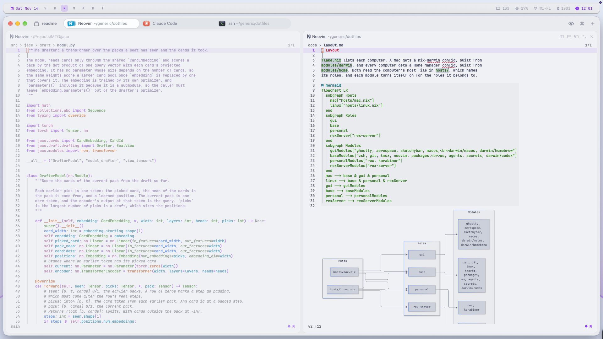
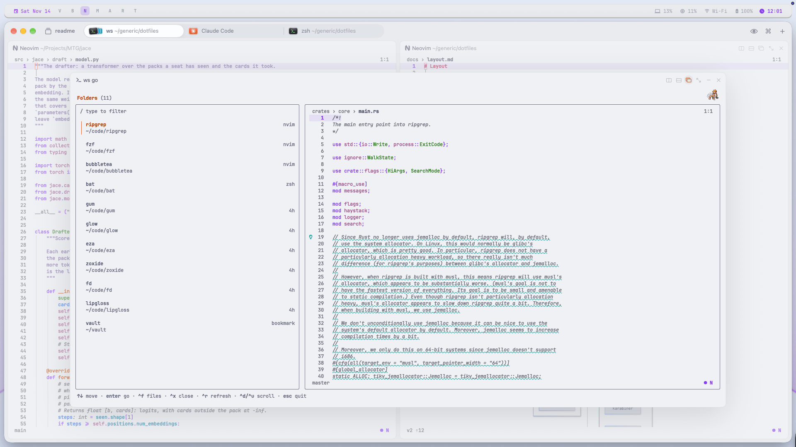
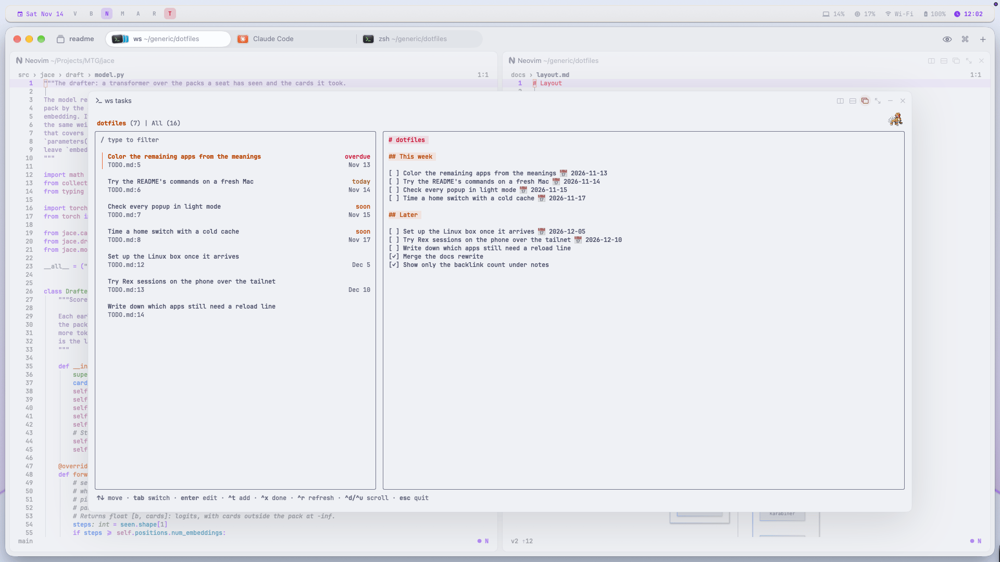

# dotfiles

One Nix flake sets up my Mac: Rex as the terminal, Neovim as the editor,
AeroSpace to tile the windows and sketchybar across the top. nix-darwin sets
macOS's own settings, and Home Manager installs most of the tools and writes
their config.
Ghostty with tmux is set up as well, with the same keys and popups except
Agents, for a computer without Rex.

The same flake has a config for a headless Linux machine that runs Rex's
server.

<picture>
  <source media="(prefers-color-scheme: dark)" srcset="assets/screen-dark.png">
  
</picture>

## How it works

- Each computer has a file in `hosts/` that lists its roles, such as `gui`
  for a computer with a screen or `personal` for one that isn't for work.
  Each module applies only to computers with the roles it names, so one
  flake can set up different computers.
- Most files under `config/` and `ai-harness/` are links into this
  checkout, so a program picks up an edit the next time it starts. Any other
  change needs a rebuild, which the commands below run.
- `ws`, a Go program in `pkgs/ws`, opens each folder, worktree and pull
  request as a Rex session with an agent in it. You switch between those
  sessions with its popups, listed below.
- In `theme/meanings.nix`, each use of color, such as `error` or `muted`,
  has a Catppuccin color. Every app's colors are generated from that file in
  light and dark mode, so changing `error` there changes it everywhere.

## Commands

```sh
home-switch     # rebuild the tools and their config, on the Mac or Linux
mac-switch      # apply macOS's settings and Homebrew apps (asks for a password)
nix-update      # update the flake's inputs, rebuild, and upgrade uv's tools
theme dark      # switch macOS and every app to dark, or to light
ws new NAME     # make a worktree on branch NAME and start an agent in it
ws pr NUMBER    # check a pull request out into its own worktree
ws rm NAME      # close a worktree's session, remove it and delete its branch
```

[docs/ws.md](docs/ws.md) has the other `ws` commands, and `ws --help` lists them
all.

Most changes need only `home-switch`. It changes only files in your home
folder, so it doesn't need your password. `mac-switch` changes macOS's
settings, the Homebrew apps and files in `/etc`, so it asks for your password.
`nix-update` runs both.

In Rex or tmux, Alt and a key opens a `ws` popup:

| Key       | Popup                                                          |
| --------- | -------------------------------------------------------------- |
| Alt-O     | Go: sessions, repositories and bookmarked folders              |
| Alt-W     | Worktrees: this project's worktrees, and all of them on a tab  |
| Alt-R     | Reviews: the pull requests and issues that need you            |
| Alt-T     | Tasks: the open tasks in your notes                            |
| Alt-A     | Agents: every running agent, the ones waiting on you first     |
| Alt-C     | Theme: switch light and dark, and pick the picture in popups   |
| Alt-/     | Keys: every key binding                                        |

<picture>
  <source media="(prefers-color-scheme: dark)" srcset="assets/picker-dark.png">
  
</picture>

<picture>
  <source media="(prefers-color-scheme: dark)" srcset="assets/reviews-dark.png">
  
</picture>

<picture>
  <source media="(prefers-color-scheme: dark)" srcset="assets/tasks-dark.png">
  
</picture>

At the left of sketchybar, after the date, are AeroSpace's four workspaces,
with the focused one in the accent color:

| Key       | Workspace |
| --------- | --------- |
| Cmd-Alt-V | Messages  |
| Cmd-Alt-B | Browser   |
| Cmd-Alt-N | Code      |
| Cmd-Alt-M | Meetings  |

Add Shift to the key to move the focused window to that workspace.

After them are three letters that light up when something needs you. From any
app, press Cmd-Alt and the letter to act on it:

| Letter | Lights up when                                         | Cmd-Alt and the letter |
| ------ | ------------------------------------------------------ | ---------------------- |
| A      | An agent is blocked on you or has failed               | Go to that agent       |
| R      | A pull request or issue is in Reviews' Needs you tab  | Open Reviews           |
| T      | A task is due by tomorrow                              | Open Tasks             |

## Documentation

| Page                               | Contents                                                    |
| ---------------------------------- | ----------------------------------------------------------- |
| [Setup](docs/setup.md)             | Setting up a new Mac or Linux machine                       |
| [Layout](docs/layout.md)           | Hosts, roles, modules and where each file is                |
| [ws](docs/ws.md)                   | ws's commands, layouts and popups, and the state it saves   |
| [Theme](docs/theme.md)             | Light and dark, and coloring another app                    |
| [AGENTS.md](AGENTS.md)             | Which rebuild each change needs, the checks and the rules   |
| [AI harness](ai-harness/README.md) | The agents' instructions, skills, settings and phone alerts |
| [LATER.md](LATER.md)               | What is still set up by hand                                |
