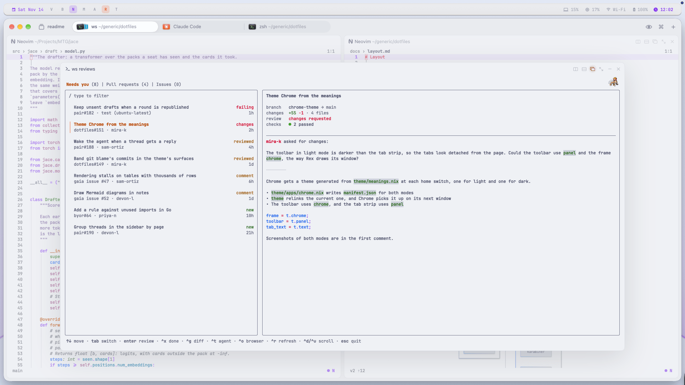
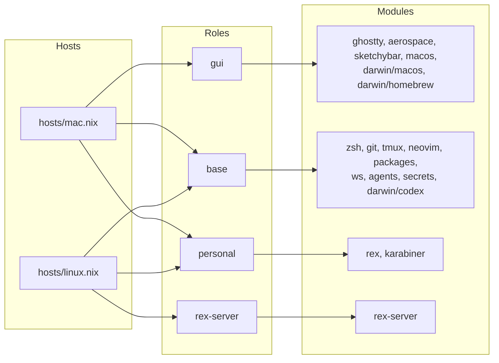

# dotfiles

## Ryan's computers, set up by one Nix flake.

This repository installs the tools and writes the settings on each of Ryan's
computers. nix-darwin sets up each Mac, and Home Manager sets up the user on
every computer, including a Linux box with no screen that runs Rex's server.
On the Mac, Ryan works in the Rex terminal with Neovim, AeroSpace tiles the
windows and sketchybar runs across the top. `ws`, built here, opens each
folder, worktree and pull request as a Rex session with an agent in it, and
draws the popups that move between them.

<picture>
  <source media="(prefers-color-scheme: dark)" srcset="assets/computer-dark.png">
  
</picture>

## Get started

Each computer keeps its checkout at `~/generic/dotfiles`, where its host
file expects it. These steps set up the two computers `flake.nix` lists,
`mac` and `linux`.

### A Mac

Install Nix, Homebrew and Claude Code. The Mac switch installs its apps
through Homebrew but can't install Homebrew itself. Claude Code goes before
the first home switch, so that the switch sets byor and pair up for it.

```sh
curl -fsSL https://install.determinate.systems/nix | sh -s -- install
/bin/bash -c "$(curl -fsSL https://raw.githubusercontent.com/Homebrew/install/HEAD/install.sh)"
curl -fsSL https://claude.ai/install.sh | bash
```

Open a new terminal, so that `nix` is on its PATH. Clone the `v2` branch,
and make the age key that opens the secrets. The key goes where sops and
sops-nix look for it on a Mac, and `age-keygen` prints its public key.

```sh
nix run nixpkgs#git -- clone -b v2 https://github.com/RyanSaxe/dotfiles ~/generic/dotfiles
mkdir -p ~/Library/Application\ Support/sops/age
nix shell nixpkgs#age -c age-keygen -o ~/Library/Application\ Support/sops/age/keys.txt
```

The new key can't open the secrets until they're encrypted to it. On a
computer whose key `.sops.yaml` already lists, add the new public key to
`.sops.yaml`, run `sops updatekeys secrets/secrets.yaml`, and commit and push
both files. Then pull on the new Mac and run the first switches:

```sh
nix run nixpkgs#git -- -C ~/generic/dotfiles pull
sudo nix run nix-darwin/master#darwin-rebuild -- switch --flake ~/generic/dotfiles#mac
nix run home-manager/master -- switch -b pre-nix --flake ~/generic/dotfiles#ryansaxe@mac
gh auth login
```

`-b pre-nix` renames any file the home switch would replace, such as an old
`~/.zshrc`, to `NAME.pre-nix`. `gh auth login` signs in to GitHub with the
gh the home switch installed, and git and Reviews use that sign-in. Rex,
Tailscale and Google Chrome are still installed by hand, as
[LATER.md](LATER.md) says.

### A Linux box

The steps match the Mac's, without Homebrew, Claude Code's installer or
nix-darwin. The home switch installs Claude Code and Codex from nixpkgs,
and runs Rex's server as a systemd user service.

```sh
curl -fsSL https://install.determinate.systems/nix | sh -s -- install
```

Open a new terminal, then clone the `v2` branch and make the age key:

```sh
nix run nixpkgs#git -- clone -b v2 https://github.com/RyanSaxe/dotfiles ~/generic/dotfiles
mkdir -p ~/.config/sops/age
nix shell nixpkgs#age -c age-keygen -o ~/.config/sops/age/keys.txt
```

As for a Mac, add the public key to `.sops.yaml` on a computer that already
opens the secrets, run `sops updatekeys secrets/secrets.yaml` there, and
commit and push. Then:

```sh
nix run nixpkgs#git -- -C ~/generic/dotfiles pull
nix run home-manager/master -- switch -b pre-nix --flake ~/generic/dotfiles#ryansaxe@linux
gh auth login
sudo ln -sfn ~/.config/codex/managed /etc/codex
loginctl enable-linger
rex server status
```

Home Manager can't write to `/etc`, so the link in `/etc/codex` is what
gives Codex its managed hooks. Lingering keeps Rex's server running while
you're logged out. The first time the server starts, it has to join your
tailnet, and `rex server status` prints the sign-in link.

After the first switches, `home-switch` and, on a Mac, `mac-switch` apply a
change. `nix-update` updates the flake's inputs and uv's tools and runs the
switches. [AGENTS.md](AGENTS.md) says which change needs which switch.
Another computer needs its own host file in `hosts/`, an entry in
`flake.nix`, and its own lines under `pair-hub-host` and `attention-watch`
in the secrets.

## Reviews

Alt-R in Rex or tmux opens Reviews, a popup of the open pull requests and
issues on GitHub that involve you. Its first tab, Needs you, lists what is
waiting on you, most urgent first: a failing check or a request for changes
on your own pull request, a review of it, a comment since your last reply,
or a pull request or issue opened this week in a repository you watch. Each
computer's watched repositories are its `attention-watch` secret.

Enter checks a pull request out into its own worktree and opens it in
Neovim, and Ctrl-T also starts an agent in a second tab there to review it.
Ctrl-X marks an item done until something new happens on it. The R in
sketchybar lights while anything needs you, and the A lights while an agent
is blocked on you or has failed.

<picture>
  <source media="(prefers-color-scheme: dark)" srcset="assets/reviews-dark.png">
  
</picture>

## Light and dark

`theme light` switches macOS and every app to Catppuccin Latte, and
`theme dark` switches them to Mocha. Changing the appearance in macOS
works too, because sketchybar runs `theme` whenever it changes.

<p>
  
  
</p>

`theme/meanings.nix` names what each color means, such as `muted` or
`code.function`, once for each mode. Each file in `theme/apps` turns those
meanings into one app's format, and each home switch renders them all for
both modes, into `~/.config/theme/dark` and `light`. `theme` points the
files in `~/.config/theme` at one mode, then reloads tmux, Ghostty and
sketchybar, which keep their colors in memory.

## How it works

`flake.nix` lists each computer. A Mac gets a nix-darwin config, built from
`modules/darwin`, and every computer gets a Home Manager config, built from
`modules/home`. Both read the computer's host file in `hosts/`, which names
its roles, and each module turns itself on for the roles it belongs to.



The modules are the files in `modules/home`, or in `modules/darwin` for the
names that start with `darwin/`. `base` is every computer's shell, editor,
tools and agent settings. `gui` is a Mac's window manager, bar, fonts, apps
and macOS settings. `personal` adds what only Ryan's own computers get,
such as Rex's settings, Karabiner and byor's rules. `rex-server` runs Rex's
server. `work` has nothing yet. Some modules also check a second role:
`packages`, for example, adds fonts for `gui` and pi, pnpm and Python for
`personal`. The theme module applies on every computer.

```text
flake.nix           the inputs, and the configs each computer gets
hosts/              each computer's roles and settings
modules/
  options.nix       the options a host file sets
  home/             one file per program, for Home Manager
  darwin/           macOS settings, Homebrew casks and /etc/codex, for nix-darwin
  codex-managed.nix the files Codex's managed hooks need in /etc/codex
theme/              what each color means, one file per app, and `theme`
pkgs/               ws's Go source and the pair package
config/             files programs read as they are, linked from the checkout
ai-harness/         the agents' instructions, references, skills and hooks
secrets/            secrets.yaml, encrypted to the keys in .sops.yaml
tests/              the prompt's test
assets/             this README's screenshots
```

Most files under `config/` and `ai-harness/` are linked from the checkout,
so a program picks up an edit when it next starts or reloads. A switch
writes everything else, and also reads a few files from those two folders
as it builds. AGENTS.md names them, since an edit to one needs a switch.

## Documentation

- [AGENTS.md](AGENTS.md) says which command applies each change, and lists
  the checks and the rules for changing this repository.
- [ai-harness/README.md](ai-harness/README.md) explains where Claude Code
  and Codex get their instructions, skills, settings and phone
  notifications.
- [pkgs/ws/AGENTS.md](pkgs/ws/AGENTS.md) explains how `ws` is put together
  and what it keeps on disk.
