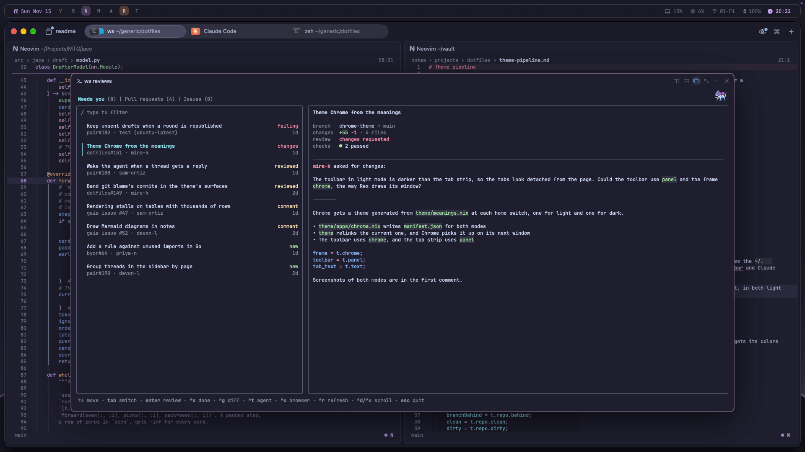
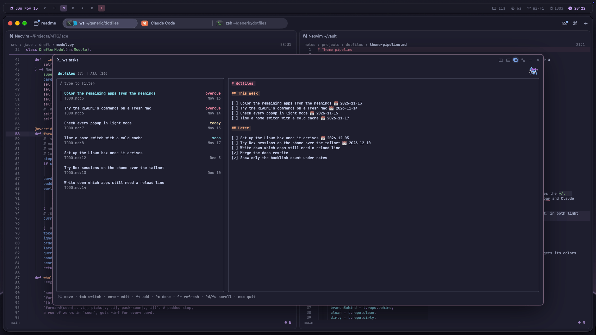

# dotfiles

These are my dotfiles: one Nix flake that sets up my Mac and a Linux server,
from macOS's settings to my editor.


## How it works

- Each computer has a file in `hosts/` that lists its roles, such as `gui`
  for a computer with a screen or `personal` for one that isn't for work.
  Each module applies only to computers with the roles it names, so one
  flake can set up different computers.
- Most files under `config/` and `ai-harness/` are links into this
  checkout, so a program picks up an edit the next time it starts. Any other
  change needs a rebuild, which the commands below run.
- `ws`, a Go program in `pkgs/ws`, opens each folder, worktree and pull
  request as a Rex session with an agent in it. You switch between those
  sessions with its popups, listed below.
- In `theme/meanings.nix`, each use of color, such as `error` or `muted`,
  has a Catppuccin color. Every app's colors are generated from that file in
  light and dark mode, so changing `error` there changes it everywhere.

## Commands

```sh
home-switch     # rebuild the tools and their config, on the Mac or Linux
mac-switch      # apply macOS's settings and Homebrew apps (asks for a password)
nix-update      # update the flake's inputs, rebuild, and upgrade uv's tools
theme dark      # switch macOS and every app to dark, or to light
ws new NAME     # make a worktree on branch NAME and start an agent in it
ws pr NUMBER    # check a pull request out into its own worktree
ws rm NAME      # close a worktree's session, remove it and delete its branch
```

[docs/ws.md](docs/ws.md) has the other `ws` commands, and `ws --help` lists them
all.

Most changes need only `home-switch`. It changes only files in your home
folder, so it doesn't need your password. `mac-switch` changes macOS's
settings, the Homebrew apps and files in `/etc`, so it asks for your password.
`nix-update` runs both.

In Rex or tmux, Alt and a key opens a `ws` popup:

| Key       | Popup                                                          |
| --------- | -------------------------------------------------------------- |
| Alt-O     | Go: repositories, worktrees and bookmarked folders             |
| Alt-S     | Sessions: the running sessions, on Go's second tab             |
| Alt-W     | Worktrees: this project's worktrees, and all of them on a tab  |
| Alt-R     | Reviews: the pull requests and issues that need you            |
| Alt-T     | Tasks: the open tasks in your notes                            |
| Alt-A     | Agents: every running agent, the ones waiting on you first     |
| Alt-C     | Theme: switch light and dark, and pick the picture in popups   |
| Alt-/     | Keys: every key binding                                        |






At the left of sketchybar, after the date, are AeroSpace's four workspaces,
with the focused one in the accent color:

| Key       | Workspace |
| --------- | --------- |
| Cmd-Alt-V | Messages  |
| Cmd-Alt-B | Browser   |
| Cmd-Alt-N | Code      |
| Cmd-Alt-M | Meetings  |

Add Shift to the key to move the focused window to that workspace.

After them are three letters that light up when something needs you. From any
app, press Cmd-Alt and the letter to act on it:

| Letter | Lights up when                                         | Cmd-Alt and the letter |
| ------ | ------------------------------------------------------ | ---------------------- |
| A      | An agent is blocked on you or has failed               | Go to that agent       |
| R      | A pull request or issue is in Reviews' Needs you tab  | Open Reviews           |
| T      | A task is due by tomorrow                              | Open Tasks             |

Cmd-Alt-A goes to failed agents first, then blocked ones, then finished
ones.

## Documentation

| Page                               | Contents                                                    |
| ---------------------------------- | ----------------------------------------------------------- |
| [Setup](docs/setup.md)             | Setting up a new Mac or Linux machine                       |
| [By hand](docs/manual.md)          | What each computer needs once after setup                   |
| [Layout](docs/layout.md)           | Hosts, roles, modules and where each file is                |
| [ws](docs/ws.md)                   | ws's commands, layouts and popups, and the state it saves   |
| [Theme](docs/theme.md)             | Light and dark, and coloring another app                    |
| [AGENTS.md](AGENTS.md)             | Which rebuild each change needs, the checks and the rules   |
| [AI harness](ai-harness/README.md) | The agents' instructions, skills, settings and phone alerts |
| [LATER.md](LATER.md)               | What the setup doesn't do yet                               |
