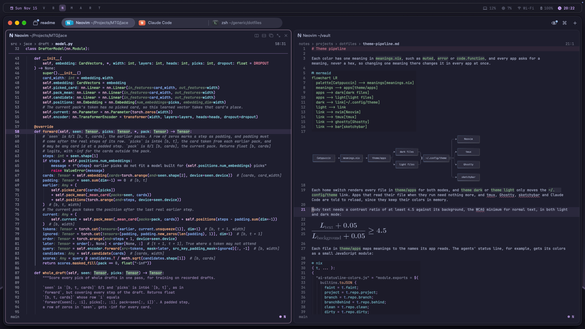
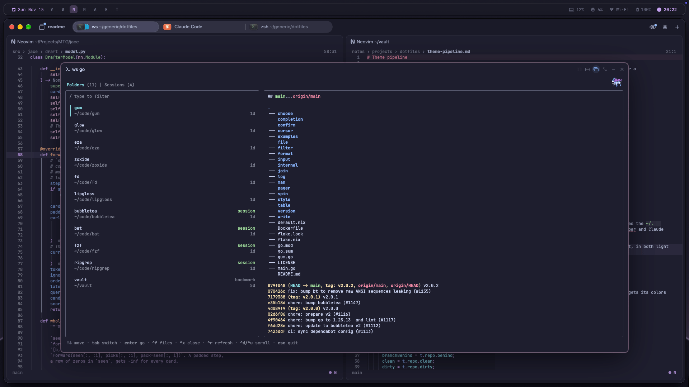

# dotfiles

One Nix flake that configures a Mac and a Linux server from macOS defaults to
Neovim, with a live Catppuccin light/dark theme and `ws`, a worktree-and-agent
workspace manager.



## How it works

- **Role-based hosts:** each machine has a file in `hosts/` listing its roles
  (`base`, `gui`, `personal`, `rex-server`). Modules enable themselves by role,
  so one flake builds Macs, Linux boxes and private work hosts.
- **Live-linked config:** most files in `config/` and `ai-harness/` symlink into
  this checkout, so edits apply on next start or reload. Everything else updates
  through a switch.
- **Worktrees and agents (`ws`):** a Go tool in `pkgs/ws` opens folders,
  worktrees and pull requests in Rex or tmux with an agent ready, plus fuzzy
  popups for switching, diffs, GitHub reviews and vault tasks.
- **Semantic Catppuccin theme:** `theme/meanings.nix` maps color roles (such as
  `error` or `muted`) to Catppuccin Latte and Mocha. Every app's colors generate
  from that single file, and `theme light`/`theme dark` switches them live.

## Commands

```sh
home-switch     # rebuild tools and config (Mac or Linux, no password)
mac-switch      # apply macOS settings, Homebrew casks and /etc (asks for password)
nix-update      # update flake inputs, run switches and upgrade uv tools
theme dark      # switch macOS and every app to dark, or to light
ws new NAME     # create a worktree on branch NAME and start an agent in it
ws pr NUMBER    # check out a pull request in its own worktree
ws project REPO # clone a GitHub repo or initialize a new project, and open it
ws rm NAME      # close a worktree's tab, remove it and delete its branch
```

Most edits need only `home-switch`. See [docs/ws.md](docs/ws.md) or `ws --help`
for all `ws` commands.

### `ws` popups (Rex and tmux)

| Key          | Popup                                                          |
| ------------ | -------------------------------------------------------------- |
| Alt-O        | Go, on Folders: repositories, worktrees and bookmarked folders |
| Alt-W        | Go, on Worktrees: every worktree, this project's first         |
| Alt-S        | Go, on Sessions: each session and worktree tab                 |
| Alt-A        | Go, on Agents: every running agent, newest report first        |
| Ctrl-F in Go | Files: the selected folder's files, to open in Neovim          |
| Alt-R        | Inbox, on Needs you: pull requests and issues needing action   |
| Alt-T        | Inbox, on Tasks: open tasks in your vault                      |
| Alt-C        | Theme: switch light and dark, and pick the popup mascot        |
| Alt-/        | Keys: every key binding                                        |




### Workspaces and attention indicators (macOS)

AeroSpace workspaces sit on the left of sketchybar (add `Shift` to move the
focused window):

| Key       | Workspace |
| --------- | --------- |
| Cmd-Alt-V | Messages  |
| Cmd-Alt-B | Browser   |
| Cmd-Alt-N | Code      |
| Cmd-Alt-M | Meetings  |

Next to them, three letters light up when something needs attention; press
`Cmd-Alt` + letter from any app to jump straight there:

| Letter | Lights up when                                              | Cmd-Alt + letter     |
| ------ | ----------------------------------------------------------- | -------------------- |
| A      | An agent failed (red), is blocked (peach) or finished (green) | Jump to that agent (failed → blocked → finished) |
| R      | A pull request or issue sits in Inbox → Needs you           | Open Inbox on it     |
| T      | A vault task is due by tomorrow                             | Open Inbox on tasks  |

## Documentation

| Page                               | Contents                                                  |
| ---------------------------------- | --------------------------------------------------------- |
| [Setup](docs/setup.md)             | Bootstrapping a new Mac, Linux box or private work flake  |
| [By hand](docs/manual.md)          | One-time manual steps after setup                         |
| [Layout](docs/layout.md)           | Hosts, roles, modules and directory map                   |
| [ws](docs/ws.md)                   | `ws` commands, places, layouts, popups and saved state    |
| [Theme](docs/theme.md)             | Light/dark switching and theming another app              |
| [AGENTS.md](AGENTS.md)             | Rebuild rules, checks and repository conventions          |
| [AI harness](ai-harness/README.md) | Global agent instructions, skills, hooks and phone alerts |
| [LATER.md](LATER.md)               | Items still manual or deferred                            |
