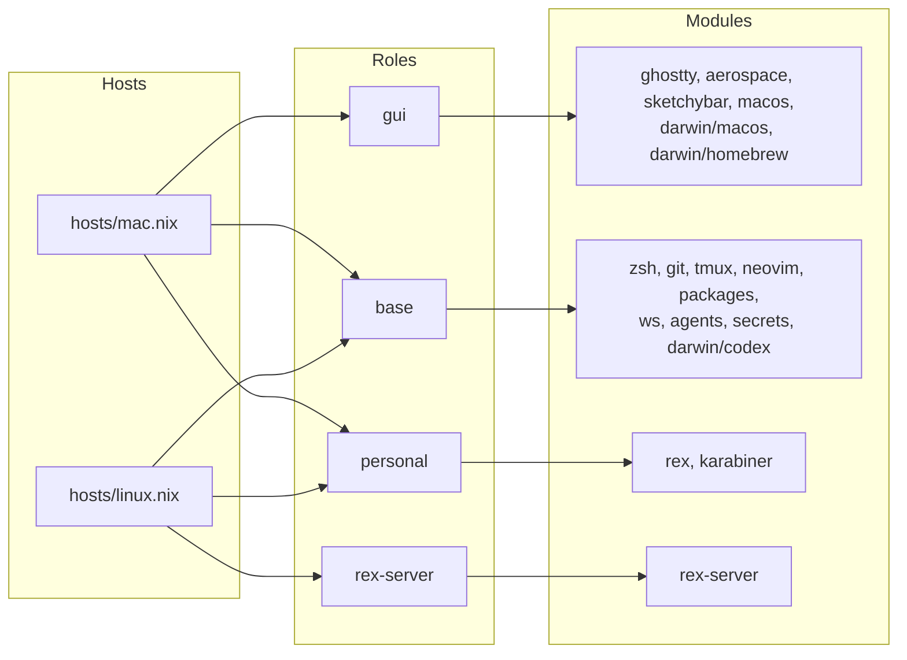

# Layout

`flake.nix` lists each computer. A Mac gets a nix-darwin config, built from
`modules/darwin`, and every computer gets a Home Manager config, built from
`modules/home`. Both read the computer's host file in `hosts/`, which names
its roles, and each module turns itself on for the roles it belongs to.



| Role         | Adds                                                  |
| ------------ | ----------------------------------------------------- |
| `base`       | The shell, editor, tools and agent settings           |
| `gui`        | A Mac's window manager, bar, fonts, apps and settings |
| `personal`   | Rex's settings, Karabiner and byor's rules            |
| `rex-server` | Rex's server, as a systemd user service               |

Some modules also check a second role. `packages`, for example, adds fonts
for `gui`, and pi, pnpm and Python for `personal`. The theme module applies
on every computer.

## Files

```text
flake.nix           the inputs, and the configs each computer gets
hosts/              each computer's roles and settings
modules/
  options.nix       the options a host file sets
  home/             one file per program, for Home Manager
  darwin/           macOS settings, Homebrew casks and /etc/codex, for nix-darwin
  codex-managed.nix the files Codex's managed hooks need in /etc/codex
theme/              what each color means, one file per app, and `theme`
pkgs/               ws's Go source and the pair package
config/             files programs read as they are, linked from the checkout
ai-harness/         the agents' instructions, references, skills and hooks
secrets/            secrets.yaml, encrypted to the keys in .sops.yaml
tests/              the prompt's test
docs/               these pages
assets/             the README's screenshots
```

Most files under `config/` and `ai-harness/` are links into the checkout,
so a program picks up an edit when it next starts or reloads. A switch
writes everything else, and also reads a few files from those two folders
as it builds. [AGENTS.md](../AGENTS.md#applying-a-change) names them and
says which switch each folder needs.
