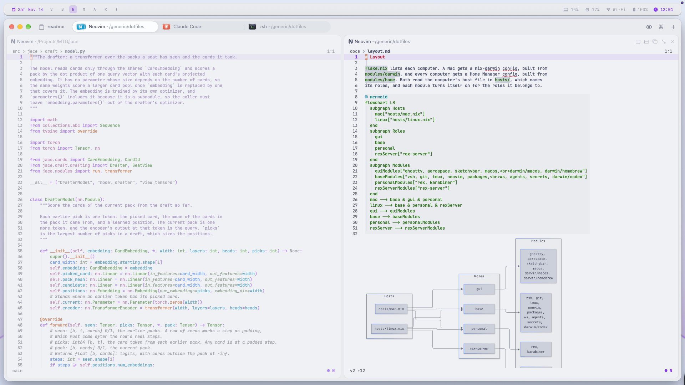
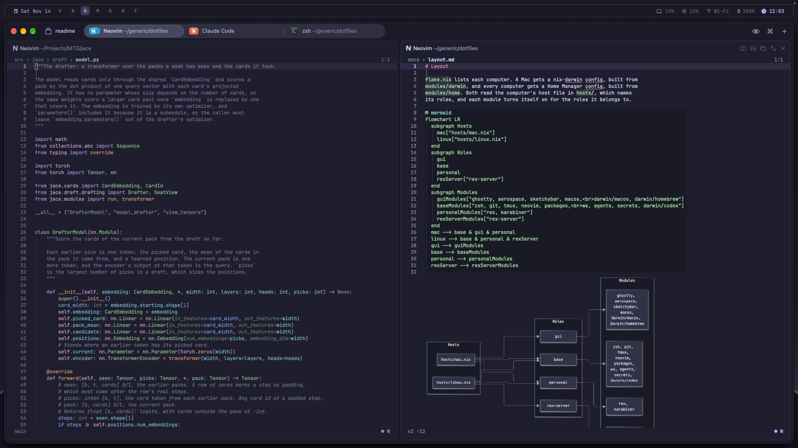

# Theme

```sh
theme light   # switch macOS and every app to Catppuccin Latte
theme dark    # switch them to Catppuccin Mocha
theme         # follow macOS's appearance
```

Changing the appearance in macOS works too, because sketchybar runs `theme`
whenever it changes.

<p>
  
  
</p>

## How it works

`theme/meanings.nix` names what each color means, such as `muted` or
`code.function`, once for each mode. Each file in `theme/apps` turns those
meanings into one app's files. Each home switch renders every app for both
modes, into `~/.config/theme/dark` and `~/.config/theme/light`, and
`theme` points the links in `~/.config/theme` at one mode. tmux, Ghostty,
sketchybar and Claude Code keep their colors in memory, so `theme` reloads
them too.

A personal Mac with a screen also gets a desktop picture for each mode,
painted from the theme's colors by `theme/desktop.py`, and `theme` sets it
on every screen at each switch.

## Color another app

Add a file to `theme/apps` that takes the meanings as `t` and returns each
file the app reads, by name:

```nix
# theme/apps/statusline.nix
{ t, ... }:
{
  "ai-statusline-colors.js" = "module.exports = ${
    builtins.toJSON {
      faint = t.faint;
      project = t.repo.project;
      model = t.info;
    }
  };\n";
}
```

Point the app at its file in `~/.config/theme`, here
`~/.config/theme/ai-statusline-colors.js`. Use only meanings, never a hex.
An app that keeps its colors in memory also needs a reload line in
`theme/theme.sh`.

## Chrome

Chrome's theme is an extension in `~/.config/theme/chrome`. Load it once on
each computer: in `chrome://extensions`, turn on Developer mode, click Load
unpacked and choose that folder. Chrome builds its theme only when it
starts, so it changes mode at its next launch.
