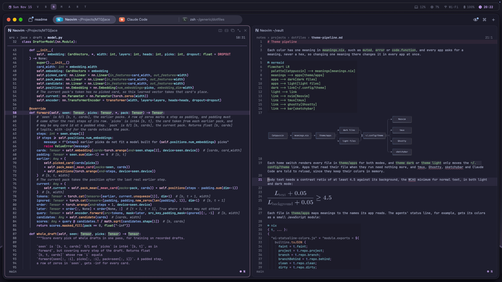

# Theme

```sh
theme light   # switch macOS and every app to Catppuccin Latte
theme dark    # switch macOS and every app to Catppuccin Mocha
theme         # follow macOS appearance
```

Toggling macOS appearance also switches every app because sketchybar runs
`theme` on system theme changes.



## How it works

`theme/meanings.nix` defines semantic color roles (such as `muted` or
`code.function`) for both modes. Each file in `theme/apps/` maps those meanings
into one app's config files. Every `home-switch` renders both modes into
`~/.config/theme/dark` and `~/.config/theme/light`, and `theme` flips the
symlinks in `~/.config/theme` to the active mode.

Apps that keep colors in memory (`tmux`, Ghostty, sketchybar and Claude Code)
are reloaded by `theme/theme.sh`. Hosts without the `personal` role skip theme
files for Claude Code, Antigravity CLI and `pi`.

On `gui` Macs, `theme/desktop.py` renders a wallpaper for each mode and `theme`
applies it on every display unless `dotfiles.desktopPicture = false` is set in
the host file.

## Color another app

Add a file under `theme/apps/` that takes `t` (the meanings) and returns the
app's files by name:

```nix
# theme/apps/statusline.nix
{ t, ... }:
{
  "ai-statusline-colors.js" = "module.exports = ${
    builtins.toJSON {
      faint = t.faint;
      project = t.repo.project;
      model = t.info;
    }
  };\n";
}
```

Point the app at `~/.config/theme/<file>` (here
`~/.config/theme/ai-statusline-colors.js`). Use meanings only, never raw hex
values. If the app caches colors in memory, add a reload line in
`theme/theme.sh`.

## Chrome

Chrome loads its unpacked theme from `~/.config/theme/chrome` once per machine
(see [By hand](manual.md#chrome-on-a-mac)). Frame and tabs use the chrome
surface (matching sketchybar); toolbar and active tab use the raised surface
(matching Neovim's current line). Because Chrome only reads themes on launch,
`theme` restarts Chrome when switching modes.
